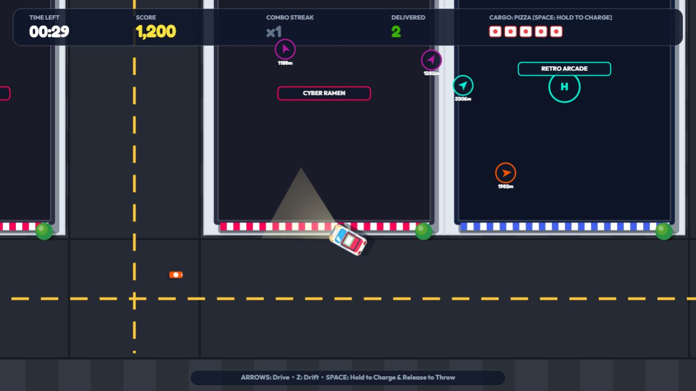
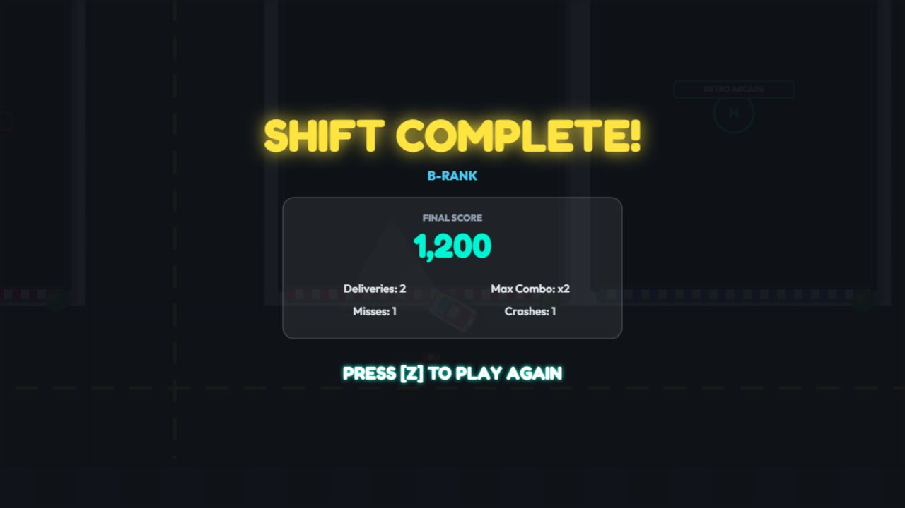

# 📦 PANIC DELIVERY

> **Top-Down Arcade Driving & Precision Courier Score Attack Engine**  
> Built with TypeScript, HTML5 Canvas, Three.js 3D Spikes, and the Web Audio API.

[](https://panic-delivery.vercel.app/)
[](https://www.typescriptlang.org/)
[](https://vitejs.dev/)
[](./src/game/__tests__/game.test.ts)
[](./LICENSE)

---

## 🎮 Play Online

Experience the live game directly in your browser:  
👉 **[https://panic-delivery.vercel.app/](https://panic-delivery.vercel.app/)**

---

## 📸 Screenshots

| Active Gameplay & Delivery Burst | Round Results & Score Rating |
| :---: | :---: |
|  |  |

---

## 🕹️ Game Overview

**PANIC DELIVERY** is an intense 120-second arcade score-attack driving game. Players navigate a densely packed city grid in a high-speed delivery van, drifting through corners, dodging obstacles, and throwing packages into storefront landing zones to build combo multipliers before time runs out.

### Key Features
- **High-Velocity Vehicle Physics:** Realistic arcade drift dynamics with controllable slip-angle, handbrake slide mechanics, and momentum preservation.
- **Hold-to-Charge Throwing Kinematics:** Hold `Space` to charge distance; release to launch packages towards targeted shops. Includes lock-on aiming indicator and short/long/wide miss classification.
- **Three Delivery Varieties:**
  - `PIZZA` 🍕: Lightweight, agile throw curve, standard points.
  - `EXPRESS` 📦: High speed, aerodynamic trajectory, high reward.
  - `FRAGILE` 🧪: Heavy mass, short range, massive combo multiplier bonus.
- **Procedural Web Audio Engine:** Synthesizes engine revs, tyre drift skids, package tosses, celebration fanfares, and sirens entirely in code via the Web Audio API with zero external audio assets.
- **Three-Tier Celebration System:**
  - *Tier 1:* Delivery Spark (+100 pts)
  - *Tier 2:* Neighborhood Party (+250 pts, 2x Combo)
  - *Tier 3:* City Goes Wild! (+500 pts, 3x+ Combo & Screen Shake)
- **High Score Persistence:** Stores personal best scores, max combos, and rank classifications (`S-RANK MASTER COURIER`, `A-RANK SPEED DEMON`, `B-RANK LOCAL DRIVER`) across browser sessions in `localStorage`.
- **Three.js 3D Visual Spike:** Includes an experimental 3D rendering spike (`spike-3d.html`) prototyping perspective camera tracking and 3D mesh instancing.

---

## ⌨️ 6-Key Arcade Input Discipline

PANIC DELIVERY strictly adheres to a responsive, 6-key retro arcade input specification:

| Key Binding | Menu / Pause Screen | Active Gameplay | Results / Game Over |
| :--- | :--- | :--- | :--- |
| **`ArrowUp`** | — | Accelerate / Drive Forward | — |
| **`ArrowDown`** | — | Brake / Reverse | — |
| **`ArrowLeft`** | — | Steer Left | — |
| **`ArrowRight`** | — | Steer Right | — |
| **`Key Z`** | **Start Game** (Fresh press) | **Drift** (Hold while steering) | **Restart Round** (Fresh press) |
| **`Space`** | *(Ignored to prevent misfires)* | **Charge & Throw Package** | *(Ignored to prevent misfires)* |

---

## 🏗️ Architecture & Codebase Map

The core engine is structured into modular, decoupled TypeScript systems located in `src/game/`:

```
src/game/
├── config.ts              # Game tuning constants, speeds, scoring, timeouts
├── types.ts               # Core interfaces (GameState, DeliveryType, CelebrationEvent)
├── game.ts                # Main game loop, state machine (MENU/PLAYING/GAMEOVER)
├── car.ts                 # Vehicle physics, steering angle, drift kinematics
├── package.ts             # Throw trajectories, cargo types, target hit/miss detection
├── target.ts              # Destination drop-zones, storefront activation & timers
├── living_city.ts         # Dynamic obstacles, civilian vehicles, pedestrian density
├── map.ts                 # City grid layout, road graph, collision boundaries
├── hud.ts                 # Real-time radar/arrow guidance, combo timers, score display
├── audio.ts               # Procedural Web Audio API sound synthesizers
├── effects.ts             # Particle cascades, drift tyre trails, screen shake
└── __tests__/
    └── game.test.ts       # 10 automated unit tests verifying core mechanics
```

---

## 🧪 Testing & Verification

The game engine is backed by an automated test suite executed via `npx tsx` and the Node.js test runner:

```bash
npm test
```

### Test Suite Output (10/10 Passing):
```
✔ World dimensions and road scale
✔ Hold-to-charge Space throw kinematics and monotonic range cap
✔ Package cooldown and automatic replenishment
✔ Three delivery varieties configuration
✔ First-delivery pacing and reachable route sequencing
✔ Moving delivery skill bonus and hold auto-release
✔ Aiming indicator and collision lock consistency
✔ Miss classification differentiates short, long and wide
✔ Keep the Party Moving celebration contract
✔ Game State Lifecycle, High Score Persistence, and 6-Key Input Discipline

ℹ tests 10 | pass 10 | fail 0
```

---

## 🚀 Local Development Setup

### Prerequisites
- Node.js 18+ (tested on Node 22 & 24)
- npm or pnpm

### Quickstart

1. **Clone the repository:**
   ```bash
   git clone https://github.com/leinhabersv-bit/panic-delivery.git
   cd panic-delivery
   ```

2. **Install dependencies:**
   ```bash
   npm install
   ```

3. **Run development server:**
   ```bash
   npm run dev
   ```
   Open `http://localhost:5173` in your browser.

4. **Run unit test suite:**
   ```bash
   npm test
   ```

5. **Build production bundle:**
   ```bash
   npm run build
   ```

6. **View Three.js 3D Spike:**
   Open `spike-3d.html` directly or navigate to `http://localhost:5173/spike-3d.html`.

---

## 📄 License

MIT © [Rithik SV](https://github.com/leinhabersv-bit)
